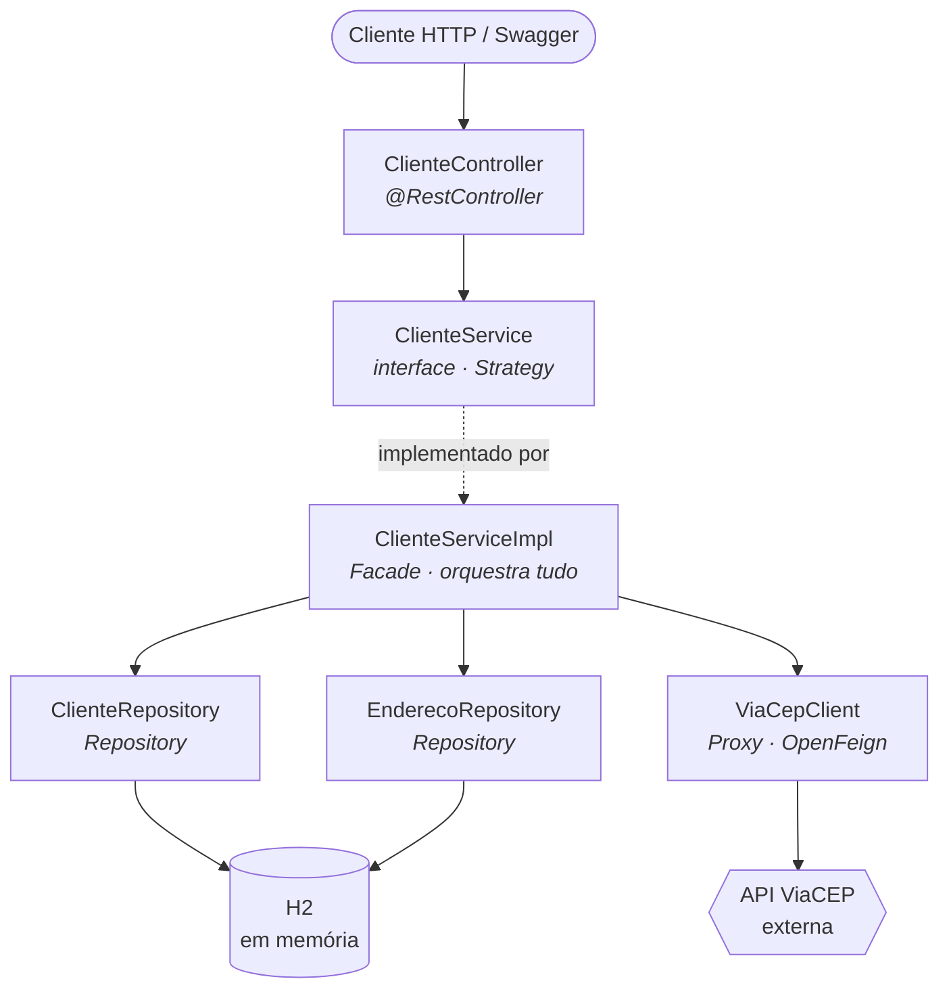
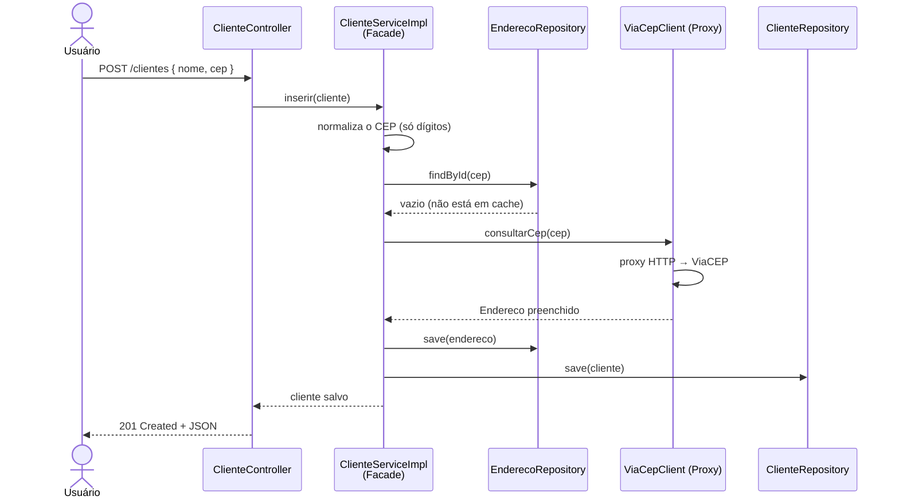

# 🧩 GoF com Spring Framework


API REST que demonstra, na prática, **Padrões de Projeto (GoF)** aplicados com o **Spring Framework**. Projeto do desafio final do curso *Design Patterns com Java: Dos Clássicos (GoF) ao Spring Framework*.

A API gerencia **Clientes** e, ao cadastrar um cliente, consulta automaticamente o endereço a partir do **CEP** usando a API pública [ViaCEP](https://viacep.com.br/) — tudo isso orquestrado por padrões de projeto que o próprio Spring aplica por baixo dos panos.

---

## 📑 Índice

- [Padrões aplicados](#-padrões-aplicados)
- [Arquitetura](#-arquitetura)
- [Fluxo de uma requisição](#-fluxo-de-uma-requisição)
- [Toques pessoais](#-toques-pessoais)
- [Stack](#-stack)
- [Como executar](#-como-executar)
- [Interface web](#-interface-web)
- [Endpoints](#-endpoints)
- [Exemplos](#-exemplos)
- [Estrutura do projeto](#-estrutura-do-projeto)
- [Aprendizados](#-aprendizados)
- [Referências](#-referências)

---

## 🎯 Padrões aplicados

| Padrão | Tipo (GoF) | Onde está no código | O que faz |
|--------|------------|---------------------|-----------|
| **Singleton** | Criacional | Beans do Spring (`@Service`, `@Repository`, `@RestController`) | O container do Spring cria uma única instância de cada bean e a reutiliza em toda a aplicação. Você não escreve `getInstance()` — o framework garante a instância única. |
| **Strategy** | Comportamental | [`ClienteService`](src/main/java/com/gtvnv/designpatterns/service/ClienteService.java) | Interface que define o contrato da regra de negócio. O controller depende da abstração, não da implementação — dá pra trocar a estratégia sem mexer em quem a consome. |
| **Facade** | Estrutural | [`ClienteServiceImpl`](src/main/java/com/gtvnv/designpatterns/service/impl/ClienteServiceImpl.java) | Esconde e orquestra integrações diversas (dois repositórios JPA + cliente HTTP ViaCEP) atrás de uma interface simples. O controller pede "salve o cliente" e não sabe da complexidade por trás. |
| **Proxy** | Estrutural | [`ViaCepClient`](src/main/java/com/gtvnv/designpatterns/client/ViaCepClient.java) | Cliente HTTP declarativo (OpenFeign). Você só declara a interface; o Spring gera em runtime um proxy dinâmico que traduz a chamada do método em uma requisição HTTP e converte a resposta JSON em objeto. |
| **Repository** | Padrão de persistência | [`ClienteRepository`](src/main/java/com/gtvnv/designpatterns/repository/ClienteRepository.java), [`EnderecoRepository`](src/main/java/com/gtvnv/designpatterns/repository/EnderecoRepository.java) | Spring Data JPA gera a implementação da camada de acesso a dados a partir da interface — mais um proxy criado pelo framework. |

> 💡 **A grande sacada:** no Java Puro você implementa os padrões manualmente. Com o Spring, o framework **já aplica esses padrões por você** — este projeto mostra onde cada um aparece na vida real.

---

## 🏗️ Arquitetura



---

## 🔄 Fluxo de uma requisição

Exemplo: `POST /clientes` com um CEP ainda não cadastrado.



---

## ✨ Toques pessoais

Além de reproduzir a ideia do projeto de referência, este repositório inclui:

- 📖 **Documentação OpenAPI/Swagger** interativa (springdoc).
- ✅ **Validação de entrada** com Bean Validation (`@Valid`, `@NotBlank`).
- 🛡️ **Tratamento global de exceções** ([`GlobalExceptionHandler`](src/main/java/com/gtvnv/designpatterns/exception/GlobalExceptionHandler.java)) com respostas HTTP padronizadas (404, 400, 500).
- 🔧 **Normalização de CEP**: aceita `01001000` ou `01001-000` e evita cadastros duplicados de endereço.
- ⚡ **Cache de endereço**: um CEP já consultado não é buscado de novo na ViaCEP.
- 📦 **Maven Wrapper** (`mvnw`): roda sem precisar instalar o Maven.

---

## 🧰 Stack

- **Java 17**
- **Spring Boot 3.3.5** (Web, Data JPA, Validation)
- **Spring Cloud OpenFeign**
- **Banco H2** em memória
- **springdoc-openapi** (Swagger UI)

---

## 🚀 Como executar

Pré-requisito: JDK 17+ instalado. O Maven **não** precisa estar instalado — o wrapper cuida disso.

```bash
# Windows
.\mvnw.cmd spring-boot:run

# Linux/Mac
./mvnw spring-boot:run
```

A aplicação sobe em `http://localhost:8080`.

- 🧪 **Swagger UI:** http://localhost:8080/swagger-ui.html
- 🗄️ **Console H2:** http://localhost:8080/h2-console
  _(JDBC URL: `jdbc:h2:mem:gofdb`, usuário `sa`, sem senha)_

---

## 🖥️ Interface web

O projeto inclui um **front-end próprio** (HTML + CSS + JS puro, sem frameworks), servido pelo próprio Spring em `src/main/resources/static` e acessível na raiz `http://localhost:8080/`.

Recursos da interface:

- 📝 Formulário de cadastro com **preview do endereço** enquanto você digita o CEP
- 📋 Tabela de clientes com ações de **editar** e **excluir**
- 🔔 **Toasts** de feedback (sucesso/erro) e estado vazio
- 🎨 Tema dark responsivo, com a identidade verde do Spring

> A UI consome exatamente os mesmos endpoints REST documentados abaixo.

---

## 🔌 Endpoints

| Método | Rota | Descrição |
|--------|------|-----------|
| `GET` | `/clientes` | Lista todos os clientes |
| `GET` | `/clientes/{id}` | Busca um cliente por id |
| `POST` | `/clientes` | Cria um cliente (endereço preenchido via ViaCEP) |
| `PUT` | `/clientes/{id}` | Atualiza um cliente |
| `DELETE` | `/clientes/{id}` | Remove um cliente |

---

## 📬 Exemplos

**Criar um cliente** (o endereço é preenchido automaticamente pelo CEP):

```bash
curl -X POST http://localhost:8080/clientes \
  -H "Content-Type: application/json" \
  -d '{"nome":"Gustavo Vianna","endereco":{"cep":"01001000"}}'
```

Resposta `201 Created`:

```json
{
  "id": 1,
  "nome": "Gustavo Vianna",
  "endereco": {
    "cep": "01001000",
    "logradouro": "Praça da Sé",
    "bairro": "Sé",
    "localidade": "São Paulo",
    "uf": "SP",
    "ddd": "11"
  }
}
```

**Listar todos:**

```bash
curl http://localhost:8080/clientes
```

**Erro de validação** (sem `nome`) retorna `400 Bad Request`:

```json
{
  "status": 400,
  "erro": "Bad Request",
  "mensagem": "nome: O nome do cliente e obrigatorio",
  "timestamp": "2026-11-02T01:57:27.82-03:00"
}
```

---

## 📂 Estrutura do projeto

```
src/main/java/com/gtvnv/designpatterns/
├─ GofSpringFrameworkApplication.java   # @SpringBootApplication + @EnableFeignClients (Singleton, Proxy)
├─ client/
│  └─ ViaCepClient.java                 # Proxy (OpenFeign)
├─ controller/
│  └─ ClienteController.java            # API REST
├─ exception/
│  ├─ GlobalExceptionHandler.java       # Tratamento global de erros
│  └─ RecursoNaoEncontradoException.java
├─ model/
│  ├─ Cliente.java                      # Entidade
│  └─ Endereco.java                     # Entidade
├─ repository/
│  ├─ ClienteRepository.java            # Repository
│  └─ EnderecoRepository.java           # Repository
└─ service/
   ├─ ClienteService.java               # Strategy (interface)
   └─ impl/
      └─ ClienteServiceImpl.java        # Strategy impl + Facade

src/main/resources/
├─ application.properties               # Configuração (H2, JPA, Swagger)
└─ static/                              # Front-end servido pelo Spring
   ├─ index.html                        # Tela de clientes
   ├─ styles.css                        # Tema dark
   └─ app.js                            # Consome a API REST
```

---

## 🎓 Aprendizados

- **Padrões não são "código extra":** o Spring já nasce estruturado em cima deles. Reconhecer onde cada um aparece (um `@Service` é Singleton, uma interface Feign é Proxy) muda a forma de ler qualquer projeto Spring.
- **Strategy + injeção de dependência** andam juntos: programar contra a interface e deixar o container escolher a implementação é o que torna o código testável e flexível.
- **Facade reduz acoplamento:** o controller não sabe que existe uma API externa, cache ou dois repositórios — ele só conversa com uma interface limpa.
- **Integração externa sem boilerplate:** com o Proxy do OpenFeign, consumir a ViaCEP virou uma interface de 3 linhas, sem `RestTemplate`, sem parsing manual de JSON.

---

## 📚 Referências

- [Design Patterns — Refactoring Guru](https://refactoring.guru/design-patterns)
- [Padrões de Projeto com Java Puro (laboratório)](https://github.com/digitalinnovationone/lab-padroes-projeto-java)
- [Padrões de Projeto com Spring (laboratório)](https://github.com/digitalinnovationone/lab-padroes-projeto-spring)
- [ViaCEP](https://viacep.com.br/)
- [Spring Cloud OpenFeign](https://spring.io/projects/spring-cloud-openfeign)
